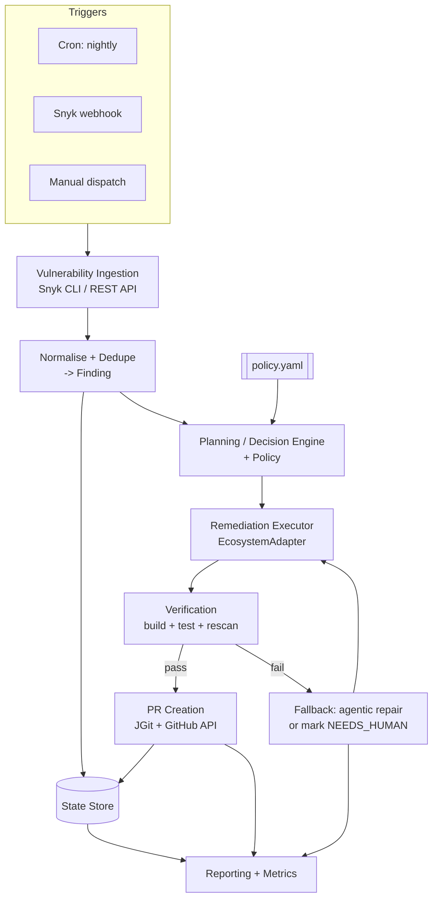
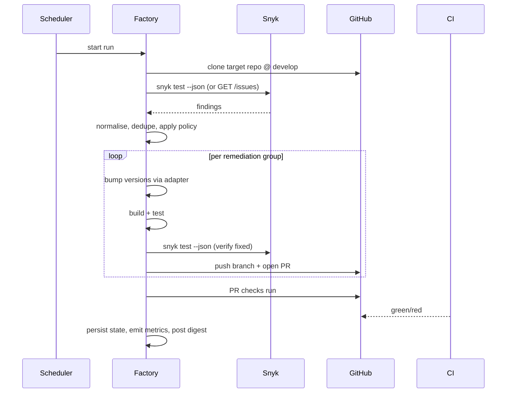
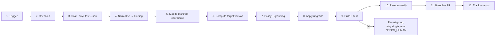
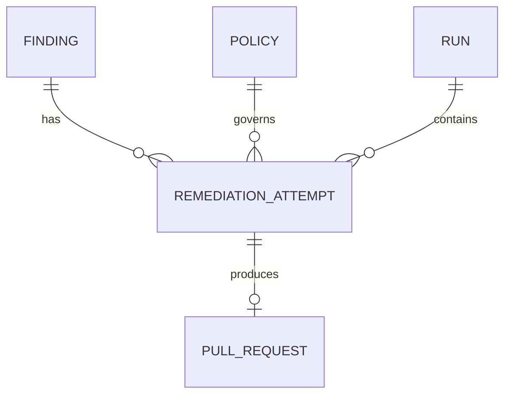

# Software Factory — Autonomous Engineering Operations

> Target repository: `https://github.com/FlutterInt/fips-martech-conversion-router`
> **Integration branch: `develop`** (GitHub's "default branch" is `master`, but it is *not* the working trunk).
> Status: **planning document** — no implementation yet.

## Stack at a glance (decided)

| | |
|---|---|
| **Language** | Java 21 (LTS) |
| **Framework** | Spring Boot 4.1.x |
| **Build** | Maven |
| **Database** | PostgreSQL (local) + Flyway |
| **Logging** | Log4j2 → `C:\logs\software-factory`, daily rolling files |
| **Config/secrets** | `application.properties`, plaintext (accepted for now) |
| **Deployment** | **Local only** — no AWS, no Bedrock, no cloud hosting |
| **Vuln source** | Snyk CLI (`snyk test --json`) + Snyk REST API |

See §5 for the full stack detail.

## 0. Target Repo — VERIFIED (discovery pass, 2026-11-09, ref `develop`)

Inspected live via the GitHub REST API with a repo-scoped PAT. Facts are confirmed unless marked ❓.
Re-runnable: `tools/inspect-target.ps1 -Ref develop -OutFile out.txt`; raw captures in `tools/discovery-develop.txt` and `tools/extra-develop.txt`.

### 0.1 Branch model — IMPORTANT CORRECTION

GitHub reports `default_branch = master`, but **`develop` is the real trunk**. `master` is stale.

| Fact | Value |
|---|---|
| **Factory base branch** | **`develop`** ✅ (all PRs target `develop`) |
| GitHub `default_branch` | `master` — **ignore it**; a PR opened with no explicit base would wrongly target `master` |
| `master` vs `develop` | **diverged**: `develop` is **+52 ahead / 10 behind** `master`, **218 files differ** |
| Total branches | **136** |
| Protected branches | **34**: `develop`, `master`, and every `release/*` (e.g. `release/26-MKTG-PROFILE-S19`) |
| `develop` protected? | **Yes** (`protected: true` in the branches list). The `/protection` endpoint 404s because the PAT lacks admin scope — ❓ read the exact rules from the UI |
| Release flow | GitFlow-ish: `feature/MAP-xxxxx` → `develop` → `release/<sprint>` → `master` |
| Branch naming in use | `feature/MAP-#####-slug`, `hotfix/...`, `release/<sprint>` |
| Last commit on `develop` | 2026-09-25 (`Feature/map 29671 trade desk api change (#498)`) |
| Tree size @ `develop` | **1 707** files (repo ~472 MB — committed `maven-wrapper.jar` blobs) |

> **Action:** set `factory.github.base-branch=develop`. Branch prefix becomes `factory/sec/...` — distinct from `feature/MAP-*` so the factory's output is instantly recognisable and easy to filter.

### 0.2 Assumption verdicts

| # | Assumption | Verdict | Detail (@ `develop`) |
|---|---|---|---|
| A1 | Ecosystem is Java/Maven | ✅ **Confirmed, +npm** | 16 Maven projects **and** one React/CRA app (`conversionrouter.dashboard/client`) with a committed `package-lock.json`. |
| A2 | Single module, not a monorepo | ❌ **Wrong** | Monorepo: **16 independent Maven projects** under `conversionrouterNew/`, **no aggregator/parent POM**, no `<modules>`. Each inherits `spring-boot-starter-parent` straight from Maven Central. |
| A3 | CI is GitHub Actions | ❌ **Wrong** | **Jenkins** — `jenkinsfiles/QA/*.groovy`, `jenkinsfiles/PROD/Jenkinsfile-deploy-services.groovy`. No `.github/` directory at all. Deploy target is **Google App Engine** (`src/main/appengine/{qa,prod}/app.yaml`). |
| A4 | Private repo in `FlutterInt` org | ✅ Confirmed | Private, language Java. |
| A5 | Snyk already monitors this repo | ✅ **Effectively confirmed** | Strong evidence: branches `feature/MAP-24233-snyk-vulnerabilities`, `MAP-24394-snyk-vulnerabilities-2`, `MAP-25936-snyk-vulnerabilities`, `MAP-27385-snyk-vulnerabilities-tradedesk-service`, `MAP-27386-snyk-vulnerabilities-tiktok-service`; PR #414 *"DO NOT MERGE! Snyk Showcase"*. ❓ still need org ID / project IDs / token. |

### 0.3 🔥 The single most important finding — this work is already being done by hand

The branch and PR history shows **Snyk remediation is a recurring, ticketed, manual workstream**:

- ≥5 dedicated `*-snyk-vulnerabilities*` feature branches, one per service, spread across multiple sprints.
- A parallel **hand-rolled Spring Boot 3 → 4 upgrade campaign**, one Jira ticket + branch + PR per module (`MAP-28747` adwords, `MAP-28748` bing, `MAP-28749` datastore, `MAP-29049` parsing, `MAP-29051` enrichment, `MAP-29053` httpendpoint, `MAP-29055` ga4, `MAP-29251` sgtm, `MAP-29255` snapchat/dashboard, `MAP-29256` facebook, `MAP-29258` tiktok, `MAP-29259` tradedesk).

**This is exactly the factory's v1 job, currently costing a developer a ticket per service per sprint.** It also means:
1. There's a **ready-made baseline**: diff those `*-snyk-vulnerabilities*` branches to learn the team's accepted remediation style.
2. There's a **collision risk** — the factory must not open a PR for a package that an in-flight `feature/MAP-*` branch is already bumping. Add a guard: before opening a PR, scan open PRs + recently-pushed branches for the same artifact coordinate.

### 0.4 ⭐ The team's own remediation pattern (reverse-engineered from `parsing-service/pom.xml`)

`conversionrouter.parsing-service/pom.xml` on `develop` already contains **hand-written, CVE-annotated `<dependencyManagement>` overrides** — the exact artefact the factory should generate:

```xml
<properties>
    <netty.version>4.2.16.Final</netty.version>
    <jackson3.version>3.2.1</jackson3.version>
</properties>
...
<dependencyManagement>
    <dependencies>
        <!-- Override Netty BOM to remediate CVE-2026-56816 (netty-codec-http3 resource
             exhaustion) present in the 4.2.15.Final line pulled in transitively via
             spring-boot-starter-webflux -> reactor-netty. -->
        <dependency>
            <groupId>io.netty</groupId><artifactId>netty-bom</artifactId>
            <version>${netty.version}</version><type>pom</type><scope>import</scope>
        </dependency>
        <!-- Override to remediate CVE-2026-59889 ... tools.jackson.core:jackson-databind < 3.1.5 -->
        <dependency>
            <groupId>tools.jackson.core</groupId><artifactId>jackson-databind</artifactId>
            <version>${jackson3.version}</version>
        </dependency>
        ...
    </dependencies>
</dependencyManagement>
```

**Implications for `MavenAdapter` — these become hard requirements, not nice-to-haves:**

| Observed convention | Factory requirement |
|---|---|
| Version pinned via a `<properties>` entry (`netty.version`), referenced by `${...}` | Bump the **property**, not the inline `<version>`. Adapter must resolve `${prop}` → property element and edit there. |
| Transitive fixes done as **BOM import override** (`netty-bom`, `type=pom`, `scope=import`) | Implement `PIN`/`BOM_OVERRIDE` strategy in Phase 1, not Phase 2 — it's the established house style. |
| Every override carries a **comment naming the CVE and the transitive path** | `PrBodyBuilder` must also emit an inline XML comment in the same format. This is a strong match for the LLM/agentic layer. |
| Jackson 3 (`tools.jackson.core`) coexists with Jackson 2 | Version resolution must not confuse `com.fasterxml.jackson.core` with `tools.jackson.core`. |

### 0.5 ⚠️ Build gotchas that will break a naive `mvn clean verify`

1. **Spotless + google-java-format is bound to the `package` phase** (`spotless-maven-plugin:2.43.0`, `googleJavaFormat 1.25.0`, GOOGLE style) with goal `check`. **Any formatting deviation fails the build.** The factory only edits `pom.xml` so this should be neutral — but verification must run `spotless:check` and, if it fails on pre-existing code, the run must report "pre-existing failure" rather than blame the bump. Establish a **green baseline build before any edit**, every run.
2. **`git-commit-id-maven-plugin`** is active → the build needs a real `.git` directory. Do **not** export a bare tree; clone properly (shallow is fine).
3. **No aggregator POM** → there is no repo-wide build. Each module is its own reactor root; build only the affected module.
4. **Maven wrapper in only 4 of 16 modules** (`bing-dispatcher`, `dashboard`, `facebook`, `sgtm-dispatcher`) → fall back to system `mvn` elsewhere. Record which was used in the `RemediationAttempt`.
5. **Pre-existing POM smells** — `parsing-service` declares `org.mockito:mockito-core` **twice** (once with `4.8.0`, once version-less). A naive "edit the `<version>` of artifact X" will hit the wrong node. The adapter must match on `groupId:artifactId` **and** handle duplicates by failing loudly.
6. **Spring Boot 4 + Jakarta/Jackson 3** means many "available" upgrades are major and API-breaking. Patch-only default is the right call here.

### 0.6 Module inventory @ `develop`

All 16 modules: standalone, `java.version = 21` (uniform — the Java 17 outlier seen on `master` is gone), packaged as GAE services.
**The Spring Boot parent version is wildly inconsistent — a mid-flight migration:**

| Spring Boot parent | Modules |
|---|---|
| **4.1.0** | adwords, datastore, enrichment, facebook, ga4, httpendpoint, parsing-service, sgtm, tiktok, tradedesk *(10)* |
| **4.0.8** | dashboard |
| **4.0.7** | bing, x-dispatcher |
| **3.5.14** | snapchat |
| **3.5.4** | aep, braze *(stale — 2 modules left behind)* |

| Module | Artifact version | Boot parent | Java | Deps | DepMgmt | Main .java | Test .java | mvnw |
|---|---|---|---|---|---|---|---|---|
| `conversionrouter.adwords-dispatcher` | *(inherited)* | 4.1.0 | 21 | 23 | 1 | 34 | 6 | — |
| `conversionrouter.aep-dispatcher` | 0.0.1-SNAPSHOT | **3.5.4** | 21 | 27 | 1 | 41 | 3 | — |
| `conversionrouter.bing-dispatcher` | 0.0.1-SNAPSHOT | 4.0.7 | 21 | 20 | 1 | 33 | 8 | ✅ |
| `conversionrouter.braze-dispatcher` | 1.0-SNAPSHOT | **3.5.4** | 21 | 18 | 1 | 27 | 4 | — |
| `conversionrouter.dashboard` | 0.0.1-SNAPSHOT | 4.0.8 | 21 | 21 | 1 | 85 | 5 | ✅ |
| `conversionrouter.datastore` | 0.0.1-SNAPSHOT | 4.1.0 | 21 | 18 | 1 | 41 | **1** | — |
| `conversionrouter.enrichment` | 0.0.1-SNAPSHOT | 4.1.0 | 21 | 15 | 1 | 27 | **0** | — |
| `conversionrouter.facebook` | 0.0.1-SNAPSHOT | 4.1.0 | 21 | 17 | 1 | 28 | 4 | ✅ |
| `conversionrouter.ga4-dispatcher` | 0.0.1-SNAPSHOT | 4.1.0 | 21 | 28 | 1 | 42 | 5 | — |
| `conversionrouter.httpendpoint` | *(inherited)* | 4.1.0 | 21 | 22 | 1 | 29 | 7 | — |
| `conversionrouter.parsing-service` | *(inherited)* | 4.1.0 | 21 | 17 | **5** | 25 | **1** | — |
| `conversionrouter.sgtm-dispatcher` | 0.0.1-SNAPSHOT | 4.1.0 | 21 | 21 | 1 | 20 | 5 | ✅ |
| `conversionrouter.snapchat-dispatcher` | 1.0-SNAPSHOT | 3.5.14 | 21 | 17 | 1 | 34 | 5 | — |
| `conversionrouter.tiktok-dispatcher` | 1.0-SNAPSHOT (artifactId `conversionrouter.tiktok`) | 4.1.0 | 21 | 19 | 1 | 27 | 3 | — |
| `conversionrouter.tradedesk-dispatcher` | 1.0-SNAPSHOT | 4.1.0 | 21 | 18 | 1 | 54 | 10 | — |
| `conversionrouter.x-dispatcher` | 1.0-SNAPSHOT | 4.0.7 | 21 | 15 | 1 | 28 | 2 | — |

**Totals: 575 main `.java`, 69 test `.java` (~8.3 : 1), 4/16 wrappers, 297 declared direct dependencies.**

### 0.7 Test-coverage risk (drives v1 policy)

| Tier | Modules | v1 policy |
|---|---|---|
| **No safety net** (0–1 test files) | `enrichment` (0), `datastore` (1), `parsing-service` (1) | **Deny-list from auto-PR.** Open a tracking issue instead, or allow PATCH-only with a `needs-careful-review` label. |
| **Thin** (2–4) | `x-dispatcher` (2), `aep` (3), `tiktok` (3), `braze` (4), `facebook` (4) | PATCH only. |
| **Reasonable** (5–10) | `dashboard`, `ga4`, `sgtm`, `snapchat`, `adwords`, `httpendpoint`, `bing`, `tradedesk` | PATCH + MINOR. |

Note `dashboard` has 85 main files but only 5 test files — worst ratio in the repo, and it's also the module with the npm surface.

### 0.8 npm surface — `conversionrouter.dashboard/client`

React 17 CRA app, `package-lock.json` committed, `test` = `react-scripts test`. Unchanged between `master` and `develop`. Markedly stale and near-certainly Snyk-flagged: `react-scripts@5.0.1`, `typescript@4.3.5`, `antd@4.16.10`, `react@17.0.2`, `redux@4.1.1`, `@types/node@16.4.13`, and **`@types/react@"17.0.065"`** — an invalid/typo'd version. Branch `MAP-25122-update-nodejs-version-of-cr-dashboard-service-to-latest-one` shows a node upgrade is already in flight.

**Recommendation: deny-list the npm client in v1.** CRA is unmaintained, so most npm findings here need a framework migration, not a bump — a terrible first proving ground. Ship Maven-only; add `NpmAdapter` in Phase 2.

### 0.9 Governance

| Item | Value |
|---|---|
| `CODEOWNERS` | Root, single global rule: `*  @mpiskorek @dereniva @velkoiva @alekssim @dudinart @yanevkal @belevmar @tunevteo @kolevsta` (9 owners) |
| Most active committers | `kolevsta-flutterint` (Stanimir Kolev) — the de-facto upgrade owners; make them the factory's default reviewers |
| Open PRs | 3, all human, all `base = develop`: #445 *MAP-22991 (DO NOT MERGE)*, #415 *Feature/map 23584*, #349 *MAP-19990* — some long-stale |
| Bot PRs | **None** → Snyk native Fix PRs are currently **off** |
| `.snyk` policy file | **Absent** |
| `renovate.json` / `dependabot.yml` | Absent |
| Dependabot alerts API | **403** — disabled, or token scope ❓ |
| PR merge style | Squash-with-PR-number (`... (#498)`) for some, plain merges for others |

### 0.10 Consequences — plan deltas

1. **`factory.github.base-branch=develop`.** Always pass an explicit `base` when opening PRs; never rely on `default_branch`.
2. **Never target `master`** — it's a release-integration branch, protected, and 218 files behind.
3. **Per-module build units.** `EcosystemAdapter` needs a `ModuleRegistry`: discover `**/pom.xml`, build/verify only the affected module.
4. **`snyk test --all-projects --detection-depth=4`** — default depth won't reach `conversionrouterNew/<module>/pom.xml`. Expect 17 project results (16 Maven + 1 npm). `manifestPath` → module mapping is a day-one requirement.
5. **Property-aware + BOM-import-aware POM editing from day one** (per §0.4), not just inline `<version>` edits.
6. **Baseline-build-first**: run the module's build *before* editing, so Spotless/pre-existing failures aren't misattributed.
7. **In-flight-work collision guard**: check open PRs and `feature/MAP-*` branches for the same artifact before opening a factory PR.
8. **Reviewer routing**: don't auto-request all 9 CODEOWNERS; request `kolevsta-flutterint`, label `software-factory`.
9. **Jenkins, not Actions** → v1 verification is the factory's own local `mvn clean verify`. ❓ Confirm whether a Jenkins PR-validation job exists or the pipelines are deploy-only.
10. **Shallow clone** (`--depth 1 --single-branch --branch develop`) and cache the workspace — 472 MB repo, 136 branches.
11. **Severity/scope for the pilot**: start with one high-test-coverage module (`tradedesk-dispatcher`, 10 tests, or `bing-dispatcher`, 8 tests + wrapper) as the single pilot target before widening.

### 0.11 Still open

- **Snyk org ID / project IDs / API token** — the only true blocker left.
- **Exact `develop` branch-protection rules** (required reviewers, required status checks) — needs admin-scope token or UI.
- **Jenkins PR-validation job** vs deploy-only pipelines.
- **Dependabot** enabled? (403 today.)
- **Private registry** — no `settings.xml` committed; presumably Maven Central + GCP artifact repos. Branch `artifactori-kiran-test` hints at an Artifactory experiment ❓.
- **Per-module build+test duration** (needed to size verification).
- Whether the **Spring Boot 4 migration** finishes first (aep/braze still on 3.5.4) — the factory should probably stay out of those two modules until they're aligned.

> ⚠️ **Security note:** the PAT used for this discovery pass was shared in plaintext in chat. **Revoke it** at <https://github.com/settings/tokens> and issue a fine-grained replacement (`contents: rw`, `pull_requests: rw`, `metadata: r`).

**Design principle (validated):** everything ecosystem-specific sits behind an `EcosystemAdapter` interface — necessary, since the repo genuinely has both Maven and npm.

---

## 1. Vision & Scope

### Vision
A long-running, autonomous "factory" that takes **work signals** (vulnerabilities, failing builds, lint debt, dependency drift, small feature tickets), plans a change, executes it against the target repo, verifies it with the repo's own build and tests, and opens a well-described PR for human review. Humans move from *doing* to *reviewing*.

### v1 Goals (first milestone)
0. Create a Proof of concept: Create a new feature branch in the target repo; 
create a java doc comment in the file 
conversionrouterNew/conversionrouter.tradedesk-dispatcher/src/main/java/com/starsgroup/martech/conversionrouter/tradedesk/service/ProcessorService.java;
commit the change;
open a pull request for kolevsta-flutterint to validate the PR.
1. Detect Snyk-reported vulnerable **dependencies** in the target repo.
2. Decide a safe target version per vulnerability (prefer patch → minor).
3. Apply the version bump to the manifest/lockfile.
4. Verify with a real build + test run.
5. Open a PR with a rich, reviewer-friendly description.
6. Report what was fixed, what was skipped, and why.

### v1 Non-Goals
- Code-level (non-dependency) vulnerability fixes (SAST findings).
- Auto-merging PRs without a human.
- Major-version upgrades or API migration work.
- Container/base-image and IaC scanning.
- Multi-repo fleet operation (design for it, ship for one repo).
- Replacing Snyk as the scanner.

### Success definition for v1
≥70% of eligible (patch/minor-fixable) vulnerabilities get an auto-generated, green-CI PR within 24h of detection, with ≥80% of those PRs merged unmodified.

---

## 2. High-Level Architecture

### Components

| Component | Responsibility |
|---|---|
| **Trigger / Scheduler** | Cron, webhook, or manual dispatch. Starts a factory run. |
| **Vulnerability Ingestion** | Pulls findings from Snyk (API/CLI/webhook), normalises them into a `Finding`. |
| **Normaliser / Deduper** | Collapses duplicate findings per (package, manifest), merges transitive paths. |
| **Planning / Decision Engine** | Applies policy: fixable? patch or minor? allow/deny list? batch or single PR? Produces a `RemediationPlan`. |
| **Remediation Executor** | Ecosystem adapter edits manifests/lockfiles (Maven `pom.xml`, npm `package.json`+lock, …). |
| **Verification** | Clean build + unit/integration tests + re-scan to prove the vuln is gone and nothing broke. |
| **PR Creation** | Branch, commit, push, open PR, labels, reviewers, template body. |
| **State Store** | Durable record of findings, attempts, PRs; prevents duplicate/flapping PRs. |
| **Reporting & Observability** | Structured logs, run summary, metrics, Slack/Teams digest. |
| **Policy Store** | Versioned YAML in this repo controlling guardrails. |

### Diagram



### Run sequence



---

## 3. Options for Vulnerability Data + Remediation

### Option A — Snyk built-in Fix PRs / Upgrade PRs (+ Snyk Broker)

**Description.** Turn on Snyk's native "Automatic fix PRs" and "Upgrade PRs" for the project. Snyk Broker only needed if the SCM is self-hosted/firewalled; for github.com SaaS it isn't.

**How it works.** Snyk SCM integration monitors the repo, and when a new vulnerability with a known fix appears Snyk itself opens a branch + PR bumping the dependency. Config lives in Snyk UI or `.snyk` policy file.

| | |
|---|---|
| **Pros** | Near-zero code; supported/maintained by Snyk; immediate value; dedupe & PR-limit built in; works today |
| **Cons** | Black box — no custom policy, no custom PR body, no custom test gate; limited batching control; doesn't extend to other task types; no path to the broader "factory" vision; Maven transitive fix support is weaker than npm |
| **Effort** | ~0.5 day (config only) |
| **Cost** | Included in Snyk licence |
| **Choose when** | You want vulnerability PRs *this week* and nothing more |

---

### Option B — Snyk REST API / v1 API polled by the factory

**Description.** Factory polls Snyk for issues and does the upgrade + PR itself.

**How it works.** Example endpoints:
- REST (current): `GET https://api.snyk.io/rest/orgs/{org_id}/issues?version=2024-10-15&scan_item.id={project_id}&scan_item.type=project&type=package_vulnerability`
- REST projects: `GET https://api.snyk.io/rest/orgs/{org_id}/projects?version=2024-10-15&target_id={target_id}`
- v1 aggregated issues (still widely used for `fixInfo`): `POST https://api.snyk.io/v1/org/{orgId}/project/{projectId}/aggregated-issues`
- v1 dependency graph / paths: `GET https://api.snyk.io/v1/org/{orgId}/project/{projectId}/dep-graph`
- Auth header: `Authorization: token $SNYK_TOKEN`

| | |
|---|---|
| **Pros** | Full control over policy, batching, PR content and test gates; no need to run a scan (uses Snyk's last snapshot); clean separation of "source of truth" vs "actuator"; fleet-scalable across many projects |
| **Cons** | API versioning churn (v1 → REST migration); data is as fresh as the last Snyk monitor run; must map Snyk's `from` paths back to a concrete manifest coordinate yourself; rate limits |
| **Effort** | 3–5 days for ingestion + mapping |
| **Cost** | Snyk licence only |
| **Choose when** | You want centralised, org-wide visibility and custom remediation logic |

---

### Option C — Snyk CLI in the factory/CI pipeline

**Description.** Run the Snyk CLI against a fresh checkout inside the factory run.

**How it works.**
```bash
snyk auth $SNYK_TOKEN
snyk test --all-projects --json --json-file-output=snyk.json --severity-threshold=medium
snyk monitor --all-projects            # push snapshot to Snyk UI
snyk fix --all-projects                # auto-remediate (ecosystem support varies)
snyk test --json | snyk-to-html -o report.html
```
The `--json` output includes `vulnerabilities[].upgradePath`, `isUpgradable`, `isPatchable`, `fixedIn`, `from`, `packageManager` — exactly the fields a remediation engine needs.

| | |
|---|---|
| **Pros** | Freshest possible data (scans the actual working tree, including your candidate fix); `upgradePath` is directly actionable; trivially re-runnable to *verify* a fix; works offline-ish in CI; same tool the security team already trusts |
| **Cons** | Needs the build toolchain installed (Maven/JDK or Node) to resolve the dep graph; slower than an API call; `snyk fix` ecosystem coverage is uneven (good for npm/pip, limited for Maven); CLI version drift |
| **Effort** | 2–3 days |
| **Cost** | Snyk licence; CI minutes |
| **Choose when** | You need to verify fixes in-loop and want the richest per-dependency fix metadata — **the best fit for v1** |

---

### Option D — Snyk Webhooks (event-driven)

**Description.** Snyk pushes `project_snapshot` events to a factory HTTPS endpoint when a project's issues change.

**How it works.** Register via `POST https://api.snyk.io/v1/org/{orgId}/webhooks` with a `url` + `secret`; verify the `X-Hub-Signature` HMAC-SHA256 on receipt; enqueue a run.

| | |
|---|---|
| **Pros** | Low latency (minutes, not a day); no polling waste; natural fit for an event-driven factory |
| **Cons** | Requires a publicly reachable, always-on HTTPS endpoint (can't be a plain GitHub Actions cron); payload is thin → still need an API call to get details; needs replay/idempotency handling; more infra |
| **Effort** | 3–4 days incl. hosting |
| **Cost** | Hosting (Azure Functions / Container App) |
| **Choose when** | Latency matters or you're already running a hosted service — **Phase 2**, layered on top of B/C |

---

### Option E — Non-Snyk / complementary: Dependabot, GHSA/OSV.dev, Renovate

**Description.** Use GitHub-native and open data sources as a fallback or cross-check.

**How it works.**
- Dependabot alerts: `GET https://api.github.com/repos/FlutterInt/fips-martech-conversion-router/dependabot/alerts?state=open`
- Advisory lookup: `GET https://api.github.com/advisories/GHSA-xxxx-xxxx-xxxx`
- OSV batch query: `POST https://api.osv.dev/v1/querybatch` with `{"queries":[{"package":{"name":"org.apache.commons:commons-text","ecosystem":"Maven"},"version":"1.9"}]}`
- Renovate: `renovate.json` config; handles version discovery, grouping, scheduling, auto-merge rules for free.

| | |
|---|---|
| **Pros** | Free; OSV gives normalised, machine-readable affected-version ranges (great for *computing* the target version); Renovate is best-in-class at the mechanical bump+PR part; Dependabot catches things Snyk's snapshot may lag on; useful false-positive cross-check |
| **Cons** | Two sources = two sets of noise and reconciliation work; Dependabot alerts need `security_events` scope and the feature enabled; Renovate PR storms if misconfigured; duplicates Snyk investment |
| **Effort** | 1 day (Renovate config) to 3 days (OSV cross-check service) |
| **Cost** | Free |
| **Choose when** | As a **cross-check for false positives** and as the version-range oracle — not as the primary source, since the company standard is Snyk |

---

### Option F — Hybrid / recommended: Snyk as source of truth + agentic remediation + own PR pipeline

**Description.** Snyk CLI/API supplies findings and verification; a deterministic engine does the easy bumps; an LLM agent (GitHub Copilot coding agent / Claude Code / Anthropic API) handles the hard ones — transitive pins, BOM edits, broken tests after a bump, changelog/breaking-change summarisation.

**How it works.** Deterministic path first (cheap, reproducible). If the build or tests fail after the bump, escalate to the agent with: the diff, the failing test output, the Snyk advisory, and the upstream changelog. Agent proposes a repair; re-run verification; cap at N attempts; otherwise mark `NEEDS_HUMAN`.

| | |
|---|---|
| **Pros** | Covers the ~30% of cases a mechanical bump can't; produces genuinely good PR descriptions and risk notes; **directly extends to the long-term vision** (same loop fixes lint, flaky tests, small features); deterministic-first keeps cost and variance low |
| **Cons** | Non-determinism; LLM token cost; needs strong sandboxing and diff review; prompt/agent maintenance; must never let the agent weaken tests to go green |
| **Effort** | 1–2 weeks on top of C |
| **Cost** | Snyk + LLM tokens (est. low $/PR) |
| **Choose when** | **Target state.** Phase 2+. |

### Recommendation

**Phased: A → C(+B) → F.**

1. **Week 1 — turn on Option A** as a safety net and baseline. It costs half a day and gives the security team immediate coverage while the factory is built. Measure its merge rate; it becomes your benchmark.
2. **v1 (Phase 1) — build on Option C**, with Option B for org-wide reporting. Rationale: the CLI's `--json` gives `upgradePath` / `fixedIn` / `isUpgradable` directly tied to the working tree, and the *same command* verifies the fix after the bump — that closed loop is the core of a trustworthy factory. Use **Option E/OSV** only to sanity-check version ranges.
3. **Phase 2 — add Option D** (webhooks) for latency and **Option F**'s agent for build-failure repair.
4. Once the factory's merge rate beats Snyk's native Fix PRs, disable Option A to avoid duplicate PRs.

> Decision note: do **not** adopt Renovate as the primary actuator. It solves bumping, not the factory's broader autonomous-engineering mandate, and introduces a second PR source.

---

## 4. Detailed v1 Pipeline



**1. Trigger.** Nightly cron 02:00 UTC + `workflow_dispatch` for manual runs. Phase 2: Snyk webhook.

**2. Checkout.** Shallow clone the target repo at **`develop`** (`--depth 1 --single-branch --branch develop`; the repo is ~472 MB), into an isolated workspace. Toolchain: **JDK 21** + Maven (system `mvn`, since only 4/16 modules ship a wrapper); Node LTS only if the npm dashboard client is in scope. Then **run a baseline `mvn -B -ntp clean verify` on the affected module before editing anything**, so pre-existing Spotless/test failures are not misattributed to the bump (§0.5).

**3. Fetch issues.**
```bash
snyk test --all-projects --detection-depth=4 --json-file-output=snyk-baseline.json --severity-threshold=medium || true
```
(CLI exits non-zero when vulns exist — don't let that kill the run.) In parallel, optionally `GET /rest/orgs/{org}/issues` for the org-level record.

**4. Normalise.** Map each raw vuln to a `Finding`: `{snykId, cve, ghsa, severity, cvss, package, currentVersion, fixedIn[], isUpgradable, isPatchable, isDirect, introducedThrough[], manifestPath}`. Dedupe by `(snykId, package, manifestPath)`; collapse multiple paths to one finding with N paths.

**5. Map issue → manifest/dependency.**
- *Direct dep:* `from[1]` matches a declared dependency → edit it in place.
- *Transitive dep (Maven):* `upgradePath` names the top-level ancestor to bump; if none exists, fall back to a `<dependencyManagement>` pin of the vulnerable artifact. Flag pins as higher-risk.
- *Transitive dep (npm):* bump the ancestor; else `overrides` in `package.json`. Flag as higher-risk.
- Multi-module: resolve per-module `pom.xml` and respect parent/BOM-managed versions — never bump a version that a parent BOM controls; bump the BOM instead.

**6. Compute target version.** Choose the **lowest** version that (a) clears all open findings for that package, (b) satisfies policy. Order of preference: patch → minor → (major only with approval label). Cross-check against OSV's `affected.ranges` to avoid Snyk's occasional over/under-wide `fixedIn`. Resolve from the registry (Maven Central `https://search.maven.org/solrsearch/select?q=g:{g}+AND+a:{a}&core=gav&rows=50&wt=json`, or `npm view <pkg> versions --json`) to confirm the version exists and isn't a pre-release.

**7. Policy + grouping.** See §8. Default grouping:

| Case | PR strategy |
|---|---|
| Critical/High severity | **One PR per vulnerability** — fast review, easy revert |
| Medium/Low patch-only bumps | **Batched weekly** into one "dependency hygiene" PR |
| Major bump required | No auto-PR; open a tracking **issue** with analysis |
| Transitive pin / override | One PR per pin, labelled `needs-careful-review` |

Cap: max 5 open factory PRs at a time; skip a finding if an open PR or a recently-closed-unmerged PR already addresses it.

**8. Apply upgrade.** Via `EcosystemAdapter.bump(coordinate, targetVersion)`:
- Maven: edit `<version>` / `<properties>` via XML-aware edit preserving formatting (or `mvn versions:use-dep-version -Dincludes=g:a -DdepVersion=X -DforceVersion=true`).
- npm: `npm install <pkg>@<ver> --save-exact=false` then commit `package-lock.json`.
- Never hand-edit lockfiles; always regenerate with the native tool.

**9. Build & test.**
- Maven: `mvn -B -ntp clean verify`
- npm: `npm ci && npm run build && npm test`

Capture full logs as artefacts. Any failure → revert the group and retry each member individually to isolate the culprit; the rest still ship.

**10. Verify the fix.** Re-run `snyk test --json`; assert the target `snykId` is absent and **no new** findings appeared. Diff baseline vs post-fix JSON and put the delta in the PR body.

**11. Branch & PR.**
- Branch: `factory/sec/{module}/{snyk-id-or-batch}-{yyyymmdd}` — e.g. `factory/sec/tradedesk-dispatcher/SNYK-JAVA-IONETTY-1234567-20261109`. Deliberately *not* `feature/MAP-*`, so factory output is filterable.
- **Base: `develop`** (always explicit — the repo's GitHub default is the stale `master`).
- Commit: `fix(deps): bump io.netty:netty-bom 4.2.15.Final -> 4.2.16.Final (CVE-2026-56816)`
- Also emit an inline `pom.xml` comment in the team's house style (§0.4) naming the CVE and the transitive path.
- PR body template: summary table (module / package / from → to / severity / CVSS / CVE / direct-or-transitive), what changed, baseline-vs-post build+test result, Snyk before/after delta, links to advisory and upstream release notes, breaking-change assessment, revert instructions, `Generated by Software Factory run #<id>` footer.
- Labels: `security`, `dependencies`, `software-factory`, severity label. Request **`kolevsta-flutterint`** rather than fanning out to all 9 global CODEOWNERS.
- **Collision guard:** before opening, check open PRs and recently-pushed `feature/MAP-*` branches for the same `groupId:artifactId`; skip and log if one is in flight (§0.3).

**12. Track & report.** Persist `RemediationAttempt` + `PullRequest`. Poll PR state on later runs to record merged/closed/stale. Emit run summary to the GitHub Actions job summary + a Slack/Teams digest.

---

## 5. Tech Stack — DECIDED

> These are locked-in decisions, not options.

| Dimension | Decision | Notes |
|---|---|---|
| **Language / runtime** | **Java 21** (LTS) | Deliberately matched to the target repo's `java.version=21` (§0.6) so the factory and the code it edits share a toolchain. Virtual threads for concurrent Snyk/GitHub/registry calls; records for the domain model; pattern matching for the decision engine; sealed interfaces for `RemediationStrategy`. |
| **Framework** | **Spring Boot 4.1.x** | `spring-boot-starter-web` (actuator + future webhook endpoint), `spring-boot-starter-data-jpa`, `spring-boot-starter-validation`, Spring `@Scheduled` for the nightly run, `RestClient` for all HTTP. Same major line the target repo is migrating to, so lessons transfer. |
| **Build** | **Maven** | Single module to start; `maven-wrapper` committed so the build is reproducible. |
| **Deployment** | **Local only** | Runs as a local Spring Boot app on the dev machine. **No AWS, no Bedrock, no Azure.** GitHub Actions hosting is deferred — Phase 1 is a locally-run process, triggered by scheduler or a local HTTP/CLI call. |
| **Database** | **PostgreSQL** (local, Docker or native install) | Via Spring Data JPA + Flyway migrations. Stores `Finding`, `RemediationAttempt`, `PullRequest`, `Run`. H2 in-memory profile for tests. |
| **Config & secrets** | **`application.properties`** | All tokens/IDs in plain `application.properties` for now — explicitly accepted. Per-env overrides via `application-local.properties`. Vaulting is a Phase 3 concern. |
| **Logging** | **Log4j2** → `C:\logs\software-factory`, daily rolling | See §5.3. Exclude `spring-boot-starter-logging` (Logback) and add `spring-boot-starter-log4j2`. |
| **Snyk access** | Snyk **CLI** invoked as an external process (`ProcessBuilder`) + Snyk **REST API** via Spring `RestClient` | Matches the Option C (+B) recommendation in §3. |
| **GitHub access** | **`org.kohsuke:github-api`** (or `RestClient` against the REST API) + **JGit** for clone/branch/commit/push | JGit keeps git operations in-process, no shell git dependency. |
| **Agentic layer (Phase 2+)** | **Spring AI** `ChatModel` abstraction, provider = **Anthropic Claude API** (primary) + optional **Ollama** local model (cheap/offline fallback) — **not** AWS Bedrock | See §11.1 for the full options analysis. `ChatModel` *is* the pluggable `LlmClient` interface — no need to hand-roll one. |

### 5.1 Key Maven dependencies

```xml
<properties>
  <java.version>21</java.version>
  <maven.compiler.release>21</maven.compiler.release>
</properties>


<!-- web + scheduling + actuator -->
spring-boot-starter-web
spring-boot-starter-actuator
spring-boot-starter-validation

<!-- persistence -->
spring-boot-starter-data-jpa
org.postgresql:postgresql
org.flywaydb:flyway-core
org.flywaydb:flyway-database-postgresql

<!-- logging: Log4j2 instead of Logback -->
spring-boot-starter-log4j2     <!-- and <exclusion> spring-boot-starter-logging everywhere -->

<!-- git + github -->
org.eclipse.jgit:org.eclipse.jgit
org.kohsuke:github-api

<!-- xml / pom manipulation for the Maven EcosystemAdapter -->
org.apache.maven:maven-model
org.dom4j:dom4j            <!-- format-preserving pom.xml edits -->

<!-- misc -->
com.fasterxml.jackson.core:jackson-databind   <!-- parse snyk test --json -->
org.projectlombok:lombok (optional)
spring-boot-starter-test / testcontainers-postgresql / wiremock
```

### 5.2 Project layout

```
software-factory/
  plan.md
  pom.xml
  mvnw / mvnw.cmd
  src/main/java/com/flutterint/softwarefactory/
    SoftwareFactoryApplication.java
    config/            # FactoryProperties, SnykProperties, GitHubProperties, RestClientConfig
    domain/            # Finding, RemediationAttempt, PullRequestRecord, Run, Policy (entities + enums)
    repository/        # Spring Data JPA repositories
    ingest/            # SnykCliClient, SnykApiClient, OsvClient, FindingNormalizer
    planning/          # PolicyEngine, RemediationPlanner, VersionResolver
    adapter/           # EcosystemAdapter (sealed), MavenAdapter, NpmAdapter
    verify/            # BuildRunner, TestRunner, RescanVerifier
    scm/               # RepoCheckoutService (JGit), PullRequestService (github-api), PrBodyBuilder
    orchestration/     # FactoryRunService, FactoryScheduler, run state machine
    web/               # FactoryController (manual trigger, run status), WebhookController (Phase 2)
    report/            # RunSummaryBuilder, metrics
  src/main/resources/
    application.properties
    log4j2-spring.xml
    db/migration/      # V1__init.sql, ...
    policy.yaml
  src/test/java/...
  src/test/resources/
    fixtures/snyk-test-output.json
```

### 5.3 Logging — Log4j2, daily rolling to `C:\logs\software-factory`

`src/main/resources/log4j2-spring.xml`:

```xml
<?xml version="1.0" encoding="UTF-8"?>
<Configuration status="WARN">
  <Properties>
    <Property name="LOG_DIR">C:/logs/software-factory</Property>
    <Property name="PATTERN">%d{yyyy-MM-dd HH:mm:ss.SSS} %-5level [%t] %X{runId} %logger{36} - %msg%n</Property>
  </Properties>

  <Appenders>
    <Console name="Console" target="SYSTEM_OUT">
      <PatternLayout pattern="${PATTERN}"/>
    </Console>

    <RollingFile name="AppFile"
                 fileName="${LOG_DIR}/software-factory.log"
                 filePattern="${LOG_DIR}/software-factory-%d{yyyy-MM-dd}-%i.log.gz">
      <PatternLayout pattern="${PATTERN}"/>
      <Policies>
        <TimeBasedTriggeringPolicy interval="1" modulate="true"/>
        <SizeBasedTriggeringPolicy size="100 MB"/>
      </Policies>
      <DefaultRolloverStrategy max="30">
        <Delete basePath="${LOG_DIR}" maxDepth="1">
          <IfFileName glob="software-factory-*.log.gz"/>
          <IfLastModified age="P90D"/>
        </Delete>
      </DefaultRolloverStrategy>
    </RollingFile>

    <!-- separate audit trail: every remediation decision -->
    <RollingFile name="AuditFile"
                 fileName="${LOG_DIR}/factory-audit.log"
                 filePattern="${LOG_DIR}/factory-audit-%d{yyyy-MM-dd}-%i.log.gz">
      <PatternLayout pattern="${PATTERN}"/>
      <Policies>
        <TimeBasedTriggeringPolicy interval="1" modulate="true"/>
      </Policies>
      <DefaultRolloverStrategy max="30"/>
    </RollingFile>
  </Appenders>

  <Loggers>
    <Logger name="com.flutterint.softwarefactory.audit" level="INFO" additivity="false">
      <AppenderRef ref="AuditFile"/>
      <AppenderRef ref="Console"/>
    </Logger>
    <Logger name="com.flutterint.softwarefactory" level="DEBUG"/>
    <Logger name="org.springframework" level="INFO"/>
    <Logger name="org.hibernate.SQL" level="INFO"/>
    <Root level="INFO">
      <AppenderRef ref="Console"/>
      <AppenderRef ref="AppFile"/>
    </Root>
  </Loggers>
</Configuration>
```

Conventions:
- **Daily rollover** (`TimeBasedTriggeringPolicy interval="1"`), plus a 100 MB size cap so a runaway build log can't produce one giant file.
- Archives are gzipped, kept 30 files / 90 days.
- Every factory run puts its `runId` into the **Log4j2 `ThreadContext` (MDC)** so all lines for a run are greppable: `ThreadContext.put("runId", run.getId())` at run start, `clearAll()` at the end.
- `com.flutterint.softwarefactory.audit` is a dedicated logger for *decisions* (policy blocked X, bumped Y 1.9→1.10.0, opened PR #123), satisfying guardrail §8.12.
- Captured Maven/npm build output from the target repo is written to per-attempt files under `C:\logs\software-factory\builds\{runId}\{attemptId}.log`, not into the main log.

### 5.4 `application.properties` (shape)

```properties
spring.application.name=software-factory

# --- datasource (local Postgres) ---
spring.datasource.url=jdbc:postgresql://localhost:5432/software_factory
spring.datasource.username=postgres
spring.datasource.password=postgres
spring.jpa.hibernate.ddl-auto=validate
spring.flyway.enabled=true

# --- snyk ---
factory.snyk.cli-path=snyk
factory.snyk.token=<snyk-token>
factory.snyk.org-id=<org-uuid>
factory.snyk.api-base-url=https://api.snyk.io
factory.snyk.api-version=2024-10-15
factory.snyk.severity-threshold=medium
factory.snyk.detection-depth=4
factory.snyk.all-projects=true

# --- github ---
factory.github.token=<pat-or-app-token>
factory.github.owner=FlutterInt
factory.github.repo=fips-martech-conversion-router
factory.github.base-branch=develop
factory.github.branch-prefix=factory/sec/
factory.github.reviewers=kolevsta-flutterint

# --- target repo module registry (monorepo, no aggregator POM) ---
factory.target.module-glob=conversionrouterNew/*/pom.xml
factory.target.denied-modules=conversionrouter.enrichment,conversionrouter.datastore,conversionrouter.parsing-service
factory.target.npm-enabled=false
factory.target.pilot-module=conversionrouter.tradedesk-dispatcher

# --- workspace / toolchain ---
factory.workspace.root=C:/factory-workspace
factory.build.maven-command=mvn -B -ntp clean verify

# --- policy ---
factory.policy.allowed-bump-types=PATCH,MINOR
factory.policy.max-open-prs=5
factory.policy.require-green-tests=true
factory.policy.dry-run=true

# --- scheduling ---
factory.schedule.cron=0 0 2 * * *
factory.schedule.enabled=true
```

---

## 6. Configuration & Secrets

**Current decision: everything lives in `application.properties` in plaintext.** This is a deliberate, accepted trade-off while the factory runs only on a local machine. Secret management is explicitly deferred.

| Setting | Purpose | Where |
|---|---|---|
| `factory.snyk.token` | Snyk CLI auth + REST API | `application.properties` |
| `factory.snyk.org-id` / `project-id` | API addressing | `application.properties` |
| `factory.github.token` | Clone, push branch, open PR | `application.properties` |
| `spring.datasource.username` / `password` | Local Postgres | `application.properties` |
| `factory.llm.*` (Phase 2+) | Agentic repair | `application.properties` |

**GitHub auth for now: a classic/fine-grained PAT** with `repo` scope (fine-grained: `contents: read/write`, `pull_requests: read/write`, `metadata: read`). A PAT is simpler than a GitHub App for a local, single-developer setup. Switch to a GitHub App when the factory moves off the local machine.

**Practical hygiene even without a vault:**
- Keep real values in `application-local.properties` and add it to `.gitignore`; commit `application.properties` with placeholder values only.
- Snyk CLI gets the token via the `SNYK_TOKEN` environment variable injected into the `ProcessBuilder`, never as a command-line argument (which would land in logs/process lists).
- Add a Log4j2 `RegexReplacement` or a redacting `MessageFactory` so a token can never be printed to `C:\logs\software-factory`.
- The factory never gets merge or admin rights on the target repo; branch protection + human review stays the real control.

**Deferred to a later phase:** environment-variable injection, OS credential store, HashiCorp Vault, GitHub App installation tokens, token rotation.

---

## 7. Data Model / State



**Persistence:** PostgreSQL via Spring Data JPA, schema managed by **Flyway** (`src/main/resources/db/migration/V1__init.sql`). `spring.jpa.hibernate.ddl-auto=validate` — Flyway owns the schema, Hibernate only verifies it. Tests run against H2 or Testcontainers Postgres.

**Finding** → table `finding`
`id` (UUID) · `fingerprint` (unique: hash of snykId+package+manifestPath) · `snykIssueId` · `cve` (text[]/join table) · `ghsa` · `severity` (enum) · `cvssScore` · `packageName` · `ecosystem` (enum) · `currentVersion` · `fixedInVersions` · `isDirect` · `isUpgradable` · `isPatchable` · `introducedThrough` (jsonb) · `manifestPath` · `firstSeenAt` · `lastSeenAt` · `status` {OPEN, IN_PROGRESS, PR_OPEN, FIXED, IGNORED, NEEDS_HUMAN, NOT_FIXABLE}

**RemediationAttempt** → table `remediation_attempt`
`id` · `runId` (FK) · findings via `attempt_finding` join table (batching) · `strategy` {DIRECT_BUMP, ANCESTOR_BUMP, PIN, OVERRIDE, AGENT} · `fromVersion` · `toVersion` · `bumpType` {PATCH, MINOR, MAJOR} · `buildResult` · `testResult` · `rescanClean` · `outcome` {SUCCESS, BUILD_FAIL, TEST_FAIL, POLICY_BLOCKED, NO_FIX_AVAILABLE} · `durationMs` · `logPath` (points into `C:\logs\software-factory\builds\...`) · `createdAt`

**PullRequestRecord** → table `pull_request`
`id` · `number` · `url` · `branch` · `attemptId` (FK) · `state` {OPEN, MERGED, CLOSED} · `checksState` · `openedAt` · `mergedAt` · `timeToMergeHours` · `reviewers` · `wasModifiedByHuman`

**Policy** — `policy.yaml` on the classpath, bound to a `@ConfigurationProperties` record; not a DB table.
`minSeverity` · `allowedBumpTypes` · `maxOpenPrs` · `batching` rules · `denyPackages[]` · `allowPackages[]` · `ignoredSnykIds[]` (with `expiresAt` + `reason`) · `requireGreenTests` · `quietHours` · `approvalRequiredFor[]`

**Run** → table `factory_run`
`id` · `trigger` {SCHEDULED, MANUAL_HTTP, WEBHOOK} · `startedAt` · `finishedAt` · `findingsSeen` · `attempted` · `prsOpened` · `status` · `errors` (jsonb)

---

## 8. Safety Guardrails

1. **No major-version bumps.** Blocked by default. The factory instead opens a tracking issue with an impact analysis. Override only via an explicit `allow-major` label on that issue.
2. **Test gate is mandatory.** A PR is never opened unless `clean verify` / `npm test` passes. The agent is **forbidden** from editing, skipping, or deleting tests to achieve green — enforced by rejecting any diff that touches `src/test/**` or `**/*.test.*` on a security run.
3. **Re-scan gate.** The target vuln must actually disappear, and no new findings may appear.
4. **Diff-scope guard.** Security PRs may only touch manifests/lockfiles (`pom.xml`, `package.json`, `package-lock.json`, `*.props`). Any other file in the diff → block and flag.
5. **Blast-radius limits.** Max 5 open factory PRs; max 10 attempts/run; one PR per package per week; back off after 3 consecutive failures on the same package.
6. **Allow/deny lists.** Deny-list internal/first-party artefacts and known-fragile deps; optionally run allow-list-only for the first two weeks.
7. **Human in the loop.** Branch protection requires ≥1 CODEOWNERS approval. No auto-merge in v1. Consider auto-merge only in Phase 3, and only for patch bumps with green CI.
8. **Rollback.** Every PR body includes the revert command; one-commit-per-PR makes `git revert` trivial. Never force-push over a human's commits on a factory branch — detect `wasModifiedByHuman` and stand down.
9. **Idempotency & anti-flap.** State store prevents reopening a PR a human closed; closed-without-merge → auto-ignore that finding for 30 days and notify.
10. **Rate limits & cost.** Respect Snyk and GitHub API limits with exponential backoff; hard token/$ cap per run for the agent; `quietHours` to avoid PRs during releases/freezes.
11. **Isolated workspace.** Each run clones the target repo into a fresh directory under `factory.workspace.root` (`C:\factory-workspace\{runId}`) and deletes it afterwards. The factory holds no production credentials — only the Snyk token and a repo-scoped GitHub PAT.
12. **Audit.** Every decision logged via the `com.flutterint.softwarefactory.audit` logger with the policy rule that drove it; `C:\logs\software-factory\factory-audit.log` rolls daily and is retained 90 days.
13. **Dry-run mode.** `factory.policy.dry-run=true` by default — the factory performs every step including build and verification but stops short of pushing a branch, writing only the proposed diff to the log. Flip to `false` only after a clean dry run is reviewed.
14. **Base-branch assertion.** Hard-fail if the resolved PR base is not `develop`. GitHub's `default_branch` (`master`) must never be used implicitly.
15. **Baseline-build gate.** Every attempt runs the module's build **before** editing. If the baseline is already red, the finding is marked `BLOCKED_PRE_EXISTING_FAILURE` and no PR is opened — the factory never ships on top of a broken module.
16. **In-flight-work guard.** Skip any finding whose `groupId:artifactId` appears in an open PR or a branch pushed within the last 30 days (§0.3).
17. **Never touch `spring-boot-starter-parent`.** The parent version is the subject of a managed human migration campaign; bumping it is out of scope for the factory.
18. **Module scope.** Only one module's `pom.xml` may change per PR. A diff spanning two modules is an automatic block.

---

## 9. Observability, Metrics & Success Criteria

**Instrumentation:**
- **Logs** — Log4j2 to `C:\logs\software-factory` (§5.3), daily rolling, `runId` in the MDC, dedicated audit appender.
- **Metrics** — **Micrometer** via `spring-boot-starter-actuator`, exposed on `/actuator/metrics` and `/actuator/prometheus`. Custom counters/timers: `factory.findings.ingested`, `factory.attempts{outcome}`, `factory.prs.opened`, `factory.run.duration`, `factory.build.duration`.
- **Health** — `/actuator/health` with custom indicators for Snyk CLI availability, GitHub reachability and Postgres.
- **Run history** — queryable from Postgres; `GET /api/runs` and `GET /api/runs/{id}` return the summary a dashboard would need.
- **Alerting (local phase)** — a run that ends `FAILED` logs at `ERROR` and writes a summary file; Slack/Teams notification deferred to Phase 2.

| Metric | Definition | v1 target |
|---|---|---|
| **MTTR (vuln)** | Snyk first-detected → PR merged, median | < 3 days (from a ~30-day baseline) |
| **Auto-fix coverage** | % of open findings with an auto-PR / % eligible | ≥70% of patch+minor-fixable |
| **PR merge rate** | merged / opened | ≥80% |
| **Unmodified merge rate** | merged with zero human commits | ≥70% |
| **Time-to-PR** | detection → PR opened | < 24h (Phase 1), < 2h (Phase 2 webhooks) |
| **Build-break rate** | factory PRs that red the CI | < 5% |
| **False-positive rate** | PRs closed as "not a real/relevant vuln" | < 10% |
| **Escalation rate** | findings → `NEEDS_HUMAN` | tracked, trending down |
| **Reviewer effort** | median review time per factory PR | < 5 min |
| **Cost per PR** | CI minutes + LLM tokens | tracked |

Weekly digest: open vulns by severity, what the factory fixed, what it couldn't and why, aging PRs.

---

## 10. Phased Roadmap

### Phase 0 — Discovery & baseline *(≈1 week)*
- ✅ **Repo discovery done** (§0, ref `develop`) — ecosystem, 16-module layout, CODEOWNERS, CI, branch model, test-coverage tiers, remediation house style. Script: `tools/inspect-target.ps1`.
- **Remaining:** inventory Snyk (org ID, project IDs, open findings by severity, onboarding method); read `develop` branch-protection rules; confirm Jenkins PR-validation job.
- **Mine the existing baseline:** diff `feature/MAP-24233-snyk-vulnerabilities`, `MAP-24394-...-2`, `MAP-25936-...`, `MAP-27385-...-tradedesk`, `MAP-27386-...-tiktok` to extract the team's accepted remediation patterns — these are free, pre-approved training examples for the PR template and the agentic layer.
- **Enable Option A** (Snyk native Fix PRs) as an immediate safety net and baseline — note it must be configured to target `develop`.
- Local environment: **JDK 21** (used for both the factory and for building the target repo — one toolchain), Maven, Snyk CLI authenticated, local **PostgreSQL**, `C:\logs\software-factory` created, fresh GitHub PAT issued.
- Measure per-module `mvn clean verify` wall time on the 2–3 candidate pilot modules.
- **Deliverables:** `discovery.md` (done — folded into §0), baseline metrics snapshot, working local toolchain, draft `policy.yaml` with the module deny-list from §0.7.

### Phase 1 — MVP *(≈3 weeks)*
- Spring Boot 4.1 / Java 21 / Maven skeleton; Log4j2 config; Flyway `V1__init.sql`; `@ConfigurationProperties` binding. ✅ *(skeleton + GitHub integration slice done — see README)*
- `SnykCliClient` — invoke `snyk test --all-projects --detection-depth=4 --json-file-output=...` via `ProcessBuilder`, parse with Jackson into `Finding`; dedupe by fingerprint; persist to Postgres.
- `ModuleRegistry` — discover `conversionrouterNew/*/pom.xml`, map each Snyk `manifestPath` → module, record Boot parent version, Java version, wrapper presence, test-file count.
- `PolicyEngine` + `VersionResolver` — patch/minor only, direct dependencies only, module deny-list from §0.7.
- `MavenAdapter` — format-preserving `pom.xml` edit supporting **inline `<version>`, `${property}` indirection, and `<dependencyManagement>` BOM-import override** (§0.4), plus the CVE comment in house style.
- `BuildRunner` (baseline-then-candidate, per module, wrapper-aware) + `RescanVerifier`.
- `RepoCheckoutService` (JGit, shallow, `develop`) + `PullRequestService` (github-api, **explicit base `develop`**) + `PrBodyBuilder` + collision guard.
- `FactoryScheduler` (`@Scheduled` nightly) + `FactoryController` manual trigger (`POST /api/runs`), **dry-run on by default**.
- **Deliverables:** first fully auto-generated security PR merged on the target repo; runbook; Micrometer metrics; Option A disabled once merge rate is proven.

### Phase 2 — Hardening & breadth *(≈4 weeks)*
- Transitive remediation (ancestor bump, `dependencyManagement` pins, npm `overrides`).
- Batching/grouping policy; open-PR caps; anti-flap; ignore-with-expiry.
- `WebhookController` for Snyk `project_snapshot` events with HMAC verification (requires exposing the local app, e.g. via a tunnel, or deferring until hosted).
- `SnykApiClient` (REST) for org-wide reporting alongside the CLI.
- OSV cross-check (Option E) for false-positive reduction and version-range accuracy.
- Agentic fallback (Option F) behind an `LlmClient` interface — local/approved provider, **no AWS Bedrock**.
- Multi-repo support (repo registry table); run-history dashboard.
- **Deliverables:** transitive fixes shipping, 2nd repo onboarded, metrics dashboard.

### Phase 3 — Agentic expansion *(ongoing)*
- Generalise `Finding` → `WorkItem` so the same plan-execute-verify-PR loop handles: flaky-test repair, lint/static-analysis debt, dead-code removal, log/observability gaps, framework upgrade campaigns, small Jira tickets.
- Task router + capability registry; per-task-type policies and quality gates.
- Self-evaluation: factory grades its own PRs; feedback loop from review comments.
- Cautious auto-merge for the highest-confidence class.
- **Deliverables:** ≥3 non-security task types in production; factory operating across the team's repos.

---

## 11. Risks & Open Questions

### Risks

| Risk | Impact | Mitigation |
|---|---|---|
| Weak/slow test suite can't catch a breaking bump | High | Measure coverage in Phase 0; require green CI + canary/staging deploy for risky bumps; keep severity-limited scope until trust is built |
| Transitive Maven fixes need risky pins | High | Treat pins as a separate, clearly-labelled, higher-scrutiny PR class |
| PR fatigue / reviewer ignores factory PRs | Medium | Caps, batching, excellent PR bodies, aging alerts, named rotation owner |
| Snyk API v1→REST migration breaks ingestion | Medium | Isolate behind an ingestion interface; pin `version=` param; contract tests |
| Duplicate PRs from Snyk native + factory + Dependabot | Medium | Single actuator rule: exactly one bot opens dependency PRs |
| Agent writes subtly wrong code | High | Deterministic-first; diff-scope guards; test-tamper detection; mandatory human review; attempt caps |
| Snyk false positives waste cycles | Medium | OSV cross-check; ignore-with-expiry; track FP rate |
| Secret leakage | Critical | Short-lived GitHub App / fine-grained tokens, log redaction, git-ignored `application-local.properties`, no prod creds in the factory |
| Upgrade fixes vuln but introduces a regression in prod | High | Revert-ready single-commit PRs; staged rollout; post-merge monitoring |
| **Local-only deployment** — factory only runs when the dev machine is on | Medium | Accepted for now; nightly `@Scheduled` plus manual `POST /api/runs`. Catch-up logic: each run reconciles *all* open findings, so a missed night self-heals. Hosting is a later decision. |
| **Plaintext secrets in `application.properties`** | Medium | Accepted for now. Keep real values in git-ignored `application-local.properties`; redact tokens in Log4j2 output; PAT is repo-scoped with no admin rights. Revisit before the factory leaves the local machine. |
| **Toolchain drift between factory and target** | Low | Both now pinned to **Java 21**, the version every target module declares (§0.6). The factory can run the target's `mvn clean verify` with its own JDK — no second toolchain to install or keep in sync. Revisit only if the target repo moves to 25. |
| Snyk CLI not on PATH / version drift on the local machine | Low | Health indicator checks `snyk --version` at startup; pin and record the version in each `Run` row. |
| **PR opened against the wrong base** — GitHub's `default_branch` is the stale `master`, not `develop` | High | Always pass `base` explicitly; assert `base == develop` before `createPullRequest`; integration test with a stubbed GitHub API. |
| **Collision with in-flight human work** — the team already runs manual `*-snyk-vulnerabilities*` and `MAP-*-spring-upgrade` branches | High | Pre-flight scan of open PRs + branches pushed in the last 30 days for the same `groupId:artifactId`; skip and log (§0.3). |
| **Spotless/google-java-format `check` bound to `package`** fails the build for reasons unrelated to the bump | Medium | Mandatory baseline build before any edit; classify failures as `PRE_EXISTING` vs `CAUSED_BY_BUMP`. |
| **Mid-flight Spring Boot 3→4 migration** makes "latest" versions API-breaking; 2 modules still on 3.5.4 | High | PATCH-first; deny-list `aep-dispatcher` and `braze-dispatcher` until aligned; never bump the `spring-boot-starter-parent` itself. |
| **Property-indirected versions** (`${netty.version}`) and BOM imports — naive `<version>` edits silently no-op | High | `MavenAdapter` resolves `${...}` to the `<properties>` element; supports `scope=import` BOM overrides; fails loudly on duplicate `groupId:artifactId` declarations (seen in `parsing-service`). |
| **Three modules have 0–1 tests** (`enrichment`, `datastore`, `parsing-service`) | High | Deny-list from auto-PR in v1; tracking issue instead (§0.7). |
| **472 MB repo, 136 branches** — clone cost per run | Low | `--depth 1 --single-branch --branch develop`; persistent cached workspace. |

### Questions for you (blocking Phase 0 completion)

> ✅ **Q1, Q2, Q5, Q6 are now ANSWERED by the §0 discovery pass (ref `develop`)** — see §0.1–0.9.

1. ~~**Ecosystem of the target repo**~~ → ✅ **Java 21 (uniform) / Maven**, Spring Boot parent **4.1.0 on 10 modules, 4.0.8 / 4.0.7 on 3, 3.5.14 / 3.5.4 on 3**, plus a React/CRA npm app in `conversionrouter.dashboard/client`. Build is **per-module** `mvn clean verify` (no aggregator). ❓ still need actual build+test durations per module.
2. ~~**Monorepo?**~~ → ✅ **Yes — 16 independent Maven projects, no aggregator/parent POM of their own.** Each inherits `spring-boot-starter-parent` from Central; versions are additionally governed by per-module `<dependencyManagement>` BOM imports.
3. **Snyk:** org ID and project ID(s)? Can you issue a token? *(Usage itself is confirmed — `*-snyk-vulnerabilities*` branches + PR #414 "Snyk Showcase" — but the IDs aren't visible from the repo side. **This is the last real blocker.**)*
4. **Snyk native Fix PRs:** off today (no bot PRs, no `.snyk` file). Enable as the Phase 0 baseline?
5. ~~**CI on the target repo**~~ → ✅ **Jenkins** (`jenkinsfiles/QA`, `jenkinsfiles/PROD`), deploying to Google App Engine. ❓ Is there a **PR-validation** job, or are these deploy-only? Also note **Spotless `check` is bound to `package`** — the build enforces google-java-format.
6. ~~**Approvals / CODEOWNERS**~~ → ✅ Global `CODEOWNERS`, 9 owners; `develop` **is** protected (34 protected branches incl. all `release/*`). ❓ The exact rules need an admin-scope token or the UI.
7. **Severity scope for v1:** Critical+High only, or Medium too?
8. **Release/change freeze windows** — the `release/<sprint>` cadence implies regular cut dates the factory should avoid. Which?
9. **Postgres:** existing local instance, or should the plan include a `docker-compose.yml`?
10. ~~**LLM for Phase 2:** Bedrock is out — GitHub Copilot, direct Anthropic/OpenAI API, or a locally-hosted model?~~ → ✅ **See §11.1 — Spring AI + Anthropic Claude API (primary), Ollama local model (fallback).**
11. **Scale:** one repo forever, or eventually N repos?
12. **Private registries:** Maven Central + GCP only, or Artifactory? *(no committed `settings.xml`; branch `artifactori-kiran-test` hints at an Artifactory trial)*
13. **Is "FIPS" in the name a compliance constraint** (FIPS 140-2 crypto) restricting permissible library versions?
14. **Is the npm dashboard client in scope for v1?** Recommendation: **no** — deny-list, ship Maven-only, add `NpmAdapter` in Phase 2.
15. **Dependabot alerts API returns 403** — disabled org-wide, or just token scope?
16. **Should the factory stay out of `aep-dispatcher` and `braze-dispatcher`** until their Spring Boot 3.5.4 → 4.x migration lands? (Recommendation: yes.)
17. **Pilot module:** OK to start with **`tradedesk-dispatcher`** (10 test files, Boot 4.1.0) as the single proving ground before widening to all 16?

---

### 11.1 LLM provider options (Bedrock excluded) — decision

> Resolves Q10. **"Deployment: local only"** (§5) constrains where the *app process* runs — it does
> not forbid outbound HTTPS calls to a hosted LLM API, same as the app already calls the GitHub and
> (soon) Snyk cloud APIs. Two genuinely different tracks follow from that distinction.

**Track 1 — hosted API (call over HTTPS, no infra to run):**

| Provider | Notes |
|---|---|
| **Anthropic Claude API** ⭐ chosen primary | Best coding/reasoning quality for exactly this job (transitive pins, BOM edits, failing-test triage); same model family as "Claude Code" named in §3 Option F. |
| OpenAI API (GPT-4.1 / o-series) | Mature alternative, equally strong at code; viable swap-in. |
| Google Gemini API | Competitive, generous free tier — good for prototyping. |
| Mistral API / Groq | Cheaper/faster, weaker reasoning — fine for low-stakes tasks (changelog summarisation, PR body copy), not for the "hard 30%". |
| **GitHub Models API** (`models.github.ai`) | Reuses the existing GitHub PAT (add `models: read` scope) for free/cheap access to GPT-4o, Claude, Llama, etc. Zero new vendor relationship — good for an early spike before paying for an Anthropic key. |
| Azure OpenAI | Still a cloud dependency despite not being AWS — out of scope given the "local only" spirit of §5. |

**Track 2 — fully local / self-hosted (true zero-cloud-dependency):**

| Option | Notes |
|---|---|
| **Ollama** ⭐ chosen fallback | OpenAI-compatible local HTTP server (`localhost:11434/v1`); runs Llama 3 / Qwen2.5-Coder / DeepSeek-Coder. Free, private, GPU-bound for good latency/quality. |
| llama.cpp server / LM Studio / vLLM | Same idea, different ergonomics/performance tradeoffs. |
| **Jlama** | Pure-JVM inference library, no native/server process — notable since the factory itself is Java, but currently behind Ollama on model selection/perf. |

Local models are currently noticeably weaker than frontier hosted models at the kind of judgment
calls Option F needs — acceptable for cheap/low-stakes tasks, risky for the hard cases, hence
"fallback" rather than "primary".

**GitHub Copilot coding agent** is a third, different shape entirely: not a raw inference API to
call in a loop, but an orchestration mode — open an issue/PR, assign Copilot, it works async and
pushes its own commits. Could replace the Option F escalation path as an alternative actuator, but
gives no `LlmClient`-style interface, so it's noted as an alternative, not the chosen integration.

**Java integration layer — decision: Spring AI**, not LangChain4j. Spring AI is the official
Spring project (same ecosystem as Spring Boot 4.1) and its `ChatModel`/`ChatClient` abstraction
**is** the pluggable `LlmClient` interface already called for in §5 — no need to hand-roll one.
Swapping providers (Anthropic ↔ Ollama ↔ GitHub Models) becomes a dependency + property change,
and the Bedrock starter simply never gets added.

---

## 12. Immediate Next Steps

1. **Unblock Snyk:** get the **org ID, project IDs and an API token**. Everything else is now known. *(§0.11)*
2. **Mine the free baseline:** `git diff develop...feature/MAP-27385-snyk-vulnerabilities-tradedesk-service` (and the other four `*-snyk-vulnerabilities*` branches). These are human-approved remediations — they define the target output format for `MavenAdapter` and `PrBodyBuilder`.
3. ~~**Scaffold the Spring Boot project**~~ → ✅ **Done.** `pom.xml` with **Java 21 + Spring Boot 4.1.0**, Log4j2 (Logback excluded from *every* starter), Jackson, validation, actuator; layered package structure per §5.2. Still to add when needed: Data JPA, Postgres, Flyway, JGit, github-api, dom4j.
4. **Wire logging first** — `log4j2-spring.xml` per §5.3; confirm `C:\logs\software-factory\software-factory.log` is created and rolls daily.
5. **Stand up local Postgres** (`software_factory` DB) and write `V1__init.sql` for the §7 schema; verify Flyway migrates on boot.
6. **Fill in `application.properties`** — `base-branch=develop`, module deny-list, `npm-enabled=false`, `dry-run=true`.
7. **Clone + baseline-build the pilot module** (`conversionrouter.tradedesk-dispatcher`) locally with JDK 21 to confirm it is green *before* the factory touches anything, and to measure build duration.
8. **Install and authenticate the Snyk CLI**, run `snyk test --all-projects --detection-depth=4 --json` against the clone, and save the output to `src/test/resources/fixtures/snyk-test-output.json` as the `SnykCliClient` test fixture.
9. **Build the ingestion vertical slice**: `SnykCliClient` → `FindingNormalizer` → `ModuleRegistry` mapping → `FindingRepository`, exposed via `POST /api/runs`. No remediation yet — prove the data pipeline and the manifest→module mapping first.
10. **Then** add `PolicyEngine` → `MavenAdapter` → `BuildRunner` → `PullRequestService`, in that order, keeping dry-run on until the proposed `pom.xml` diffs match the house style in §0.4.
11. **Revoke the PAT** shared in chat and issue a fine-grained replacement.


